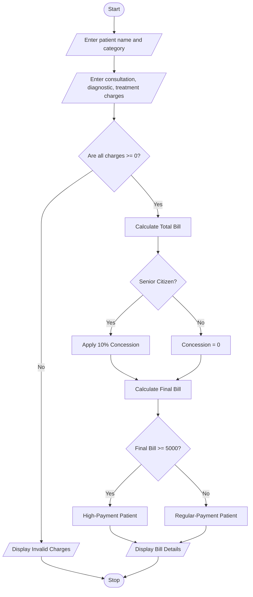

#1. Problem Statement
To develop a Python program to calculate a patient's hospital bill by adding consultation, diagnostic, and treatment charges. Apply conditional concessions based on the patient's age, validate the billing details, and classify the patient according to the final bill amount

#2. Assumptions
1. Consultation, diagnostic, and treatment charges must be non-negative.
2. Patients below 5 years receive a 20% concession.
3. Patients aged 60 years or above receive a 10% concession.
4. Other patients do not receive a concession.
5. A bill up to ₹1,000 is classified as Low Payment.
6. A bill from ₹1,001 to ₹5,000 is classified as Medium Payment.
7. A bill above ₹5,000 is classified as High Payment.

  ## Algorithm
1. Start.
2. Read patient name, age, and hospital charges.
3. Check whether age and charges are valid.
4. Calculate the total charges.
5. Apply the concession based on age.
6. Calculate the final bill.
7. Classify the patient according to the final bill.
8. Display the bill details and patient category.
9. Stop.

#5.pseudo code
START
INPUT name, age
INPUT consultation, diagnostic, treatment

IF age < 0 OR any charge < 0
    PRINT "Invalid Input"
ELSE
    total = consultation + diagnostic + treatment

    IF age < 5
        concession = total * 0.20
    ELSE IF age >= 60
        concession = total * 0.10
    ELSE
        concession = 0
    END IF

    final_bill = total - concession

    IF final_bill <= 1000
        category = "Low Payment"
    ELSE IF final_bill <= 5000
        category = "Medium Payment"
    ELSE
        category = "High Payment"
    END IF

    PRINT total, concession, final_bill, category

STOP
#6.python source code

name = input("Enter patient name: ")
age = int(input("Enter age: "))

c = float(input("Consultation charge: "))
d = float(input("Diagnostic charge: "))
t = float(input("Treatment charge: "))

if age < 0 or c < 0 or d < 0 or t < 0:
    print("Invalid Input")
else:
    total = c + d + t

    if age < 5:
        discount = total * 0.20
    elif age >= 60:
        discount = total * 0.10
    else:
        discount = 0

    final = total - discount

    if final <= 1000:
        category = "Low Payment"
    elif final <= 5000:
        category = "Medium Payment"
    else:
        category = "High Payment"

    print("\n--- Hospital Bill ---")
    print("Patient Name:", name)
    print("Total Charges:", total)
    print("Concession:", discount)
    print("Final Bill:", final)
    print("Patient Category:", category)

#7.sample output
Enter patient name: Ravi
Enter age: 65
Consultation charge: 200
Diagnostic charge: 500
Treatment charge: 1000

--- Hospital Bill ---
Patient Name: Ravi
Total Charges: 1700.0
Concession: 170.0
Final Bill: 1530.0
Patient Category: Medium Payment

#8.conclusion
The Python program successfully calculates hospital charges, applies age-based concessions, validates the input, and classifies patients according to the payment policy using conditional statements.
    

