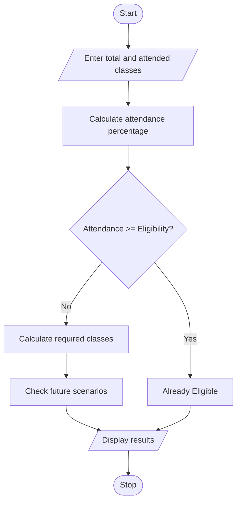

#1.Problem Statement:
Develop a Python program to calculate a student's current attendance percentage and find the minimum number of consecutive classes required to reach the minimum eligibility percentage under different future attendance scenarios.

#2.Assumptions
1. Total conducted classes are entered by the user.
2. Attended classes are entered by the user.
3. Minimum eligibility attendance is 75%.
4. Future classes may be attended or missed.
5. Attendance percentage is calculated automatically.
6. Only whole classes are considered.

#3. Algorithm
1. Start.
2. Input total classes and attended classes.
3. Calculate current attendance percentage.
4. Input eligibility percentage.
5. Calculate required consecutive classes.
6. Consider future scenarios (attending all classes or missing some).
7. Display attendance percentage and required classes.
8. Stop.

#5.pseudo code
START

INPUT total_classes
INPUT attended_classes
INPUT eligibility

attendance = (attended_classes / total_classes) * 100

IF attendance >= eligibility
    PRINT "Already Eligible"
ELSE
    INPUT future_attendance_rate

    WHILE attendance < eligibility
        total_classes = total_classes + 1
        attended_classes = attended_classes + future_attendance_rate
        attendance = attended_classes / total_classes * 100

    PRINT required_classes

DISPLAY attendance

#6.python source code

import math

# Input
total = int(input("Enter total classes: "))
attended = int(input("Enter attended classes: "))
threshold = float(input("Enter eligibility percentage: "))

# Validation
if total <= 0 or attended < 0 or attended > total:
    print("Invalid attendance details")

else:
    current = (attended / total) * 100

    print("Current Attendance:", round(current, 2), "%")

    if current >= threshold:
        print("Already Eligible")

    else:
        # Scenario 1: Attend all future classes
        required = math.ceil(
            (threshold * total / 100 - attended) /
            (1 - threshold / 100)
        )

        print("If all future classes are attended:")
        print("Required classes:", max(0, required))

        # Scenario 2: Attend 4 out of every 5 classes
        future_attended = 4
        future_total = 5

        found = False

        for i in range(1, 10001):
            new_attended = attended + (i // future_total) * future_attended
            new_total = total + i

            # Account for remaining classes in the 4-out-of-5 pattern
            new_attended = attended + (i // 5) * 4 + min(i % 5, 4)

            percentage = (new_attended / new_total) * 100

            if percentage >= threshold:
                print("If attending 4 out of every 5 classes:")
                print("Required classes:", i)
                found = True
                break

        if not found:
            print("Eligibility not reached in search range")
#7.sample output

Enter total classes: 100
Enter attended classes: 60
Enter eligibility percentage: 75

Current Attendance: 60.0 %

If all future classes are attended:
Required classes: 60

If attending 4 out of every 5 classes:
Eligibility not reached in search range

#8.conclusion
The program calculates current attendance and determines how many future classes a student must attend to reach the eligibility percentage under different attendance scenarios.

     

