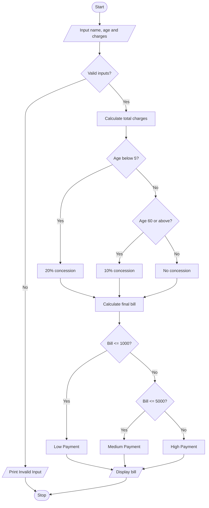

#1.Problem Statement

To calculate hospital bills by adding consultation, diagnostic, and treatment charges, apply age-based concessions, validate inputs, and classify patients according to the final bill amount

#2.Assumptions
1. All charges and age must be non-negative.
2. Age below 5 years gets a 20% concession.
3. Age 60 years or above gets a 10% concession.
4. Other patients get no concession.
5. Final bill up to ₹1,000: Low Payment.
6. Final bill up to ₹5,000: Medium Payment.
7. Final bill above ₹5,000: High Payment.

#3.Algorithm
1. Start.
2. Input patient name, age, and charges.
3. Validate age and charges.
4. Calculate total charges.
5. Apply concession based on age.
6. Calculate final bill.
7. Classify the patient based on the final bill.
8. Display the bill details.
9. Stop.

#5.python source code

START
INPUT name, age, consultation, diagnostic, treatment

IF age < 0 OR any charge < 0
    PRINT "Invalid Input"
ELSE
    total = consultation + diagnostic + treatment

    IF age < 5
        discount = total * 0.20
    ELSE IF age >= 60
        discount = total * 0.10
    ELSE
        discount = 0
    END IF

    final = total - discount

    IF final <= 1000
        category = "Low Payment"
    ELSE IF final <= 5000
        category = "Medium Payment"
    ELSE
        category = "High Payment"
    END IF

    PRINT total, discount, final, category
END IF

#6.python source code

name = input("Enter patient name: ")
age = int(input("Enter age: "))
c = float(input("Consultation charge: "))
d = float(input("Diagnostic charge: "))
t = float(input("Treatment charge: "))

if age < 0 or c < 0 or d < 0 or t < 0:
    print("Invalid Input")
else:
    total = c + d + t

    if age < 5:
        discount = total * 0.20
    elif age >= 60:
        discount = total * 0.10
    else:
        discount = 0

    final = total - discount

    if final <= 1000:
        category = "Low Payment"
    elif final <= 5000:
        category = "Medium Payment"
    else:
        category = "High Payment"

    print("\n--- Hospital Bill ---")
    print("Patient:", name)
    print("Total Charges:", total)
    print("Concession:", discount)
    print("Final Bill:", final)
    print("Category:", category)
#7.sample output

Enter patient name: Ravi
Enter age: 65
Consultation charge: 200
Diagnostic charge: 500
Treatment charge: 1000

--- Hospital Bill ---
Patient: Ravi
Total Charges: 1700.0
Concession: 170.0
Final Bill: 1530.0
Category: Medium Payment

#8.conclusion

The program calculates hospital bills, applies age-based concessions, validates inputs, and classifies patients using simple Python conditional statements.

      

   
