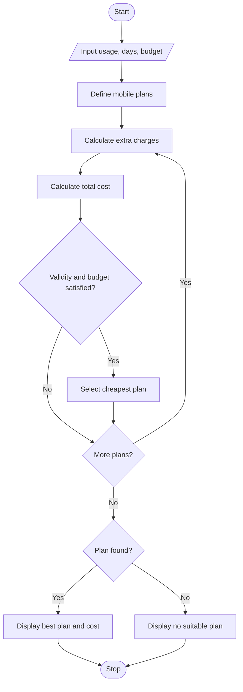

#1. Problem Statement
To develop a Python program that compares different mobile plans based on data usage, call usage, validity, and budget. Calculate extra charges and display the most economical eligible mobile plan.

#2. Assumptions
1. Three mobile plans are available.
2. Each plan has a fixed cost, data limit, and validity.
3. Extra data usage costs ₹10 per GB.
4. User enters data usage, required validity, and budget.
5. Plans exceeding the budget or validity are rejected.
6. The cheapest eligible plan is selected.

#3.Algorithm
1. Start.
2. Read data usage, validity, and budget.
3. Define three mobile plans.
4. Calculate extra data charges for each plan.
5. Calculate total plan cost.
6. Check budget and validity.
7. Select the cheapest eligible plan.
8. Display plan details and total cost.
9. Stop.

#5.pseudo code

START
INPUT usage, validity, budget

SET plans with cost, data, days

FOR each plan:
    IF usage > plan data:
        extra = (usage - plan data) * 10
    ELSE:
        extra = 0

    total = plan cost + extra

    IF total <= budget AND plan days >= validity:
        SELECT cheapest plan

IF no plan eligible:
    PRINT "No suitable plan"
ELSE:
    PRINT cheapest plan and total cost

#6.python source code

usage = float(input("Enter data usage (GB): "))
days = int(input("Enter required validity: "))
budget = float(input("Enter budget: "))

plans = [
    ["Basic", 199, 2, 28],
    ["Standard", 299, 3, 56],
    ["Premium", 399, 5, 84]
]

best = None

for p in plans:
    extra = max(0, usage - p[2]) * 10
    total = p[1] + extra

    if p[3] >= days and total <= budget:
        if best is None or total < best[0]:
            best = (total, p[0], extra)

if best:
    print("\nBest Plan:", best[1])
    print("Extra Charges: Rs.", best[2])
    print("Total Cost: Rs.", best[0])
else:
    print("No suitable plan available")

#7.sample output

Enter data usage (GB): 2.5
Enter required validity: 28
Enter budget: 350

Best Plan: Basic
Extra Charges: Rs. 5.0
Total Cost: Rs. 204.0

#8.conclusion

The program compares different mobile plans, calculates extra charges, and selects the cheapest plan according to the user's budget and validity requirements.
    
