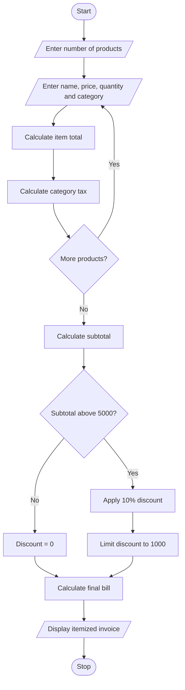

#1. Problem Statement
To develop a Python program to calculate the total bill for multiple products based on product price, quantity, category-specific taxes and discounts. Apply threshold discounts and maximum concession limits, then generate an itemized invoice.

#2.Assumptions
1. The user enters the number of products.
2. Each product has a name, price and quantity.
3. Different categories have different tax rates.
4. If subtotal is above ₹5,000, a 10% discount is applied.
5. Maximum discount is limited to ₹1,000.
6. Tax is calculated after discount.
7. The final bill includes all product costs and taxes.

 #3.Algorithm
1. Start the program.
2. Read the number of products.
3. Enter product name, price, quantity and category.
4. Calculate item total (price × quantity).
5. Apply category-based tax.
6. Calculate subtotal.
7. Check discount eligibility.
8. Apply 10% discount if subtotal is above ₹5,000.
9. Limit discount to ₹1,000.
10. Calculate final bill.
11. Display the itemized invoice.
12. Stop the program.

#5.pseudo code

START

INPUT number of products
subtotal = 0
tax_total = 0

FOR each product:
    INPUT name, price, quantity, category

    item_total = price * quantity
    subtotal = subtotal + item_total

    IF category = Food:
        tax = 5%
    ELSE IF category = Electronics:
        tax = 18%
    ELSE:
        tax = 12%

    tax_amount = item_total * tax / 100
    tax_total = tax_total + tax_amount

IF subtotal > 5000:
    discount = subtotal * 10 / 100
    discount = MIN(discount, 1000)
ELSE:
    discount = 0

final_bill = subtotal + tax_total - discount

DISPLAY invoice
STOP

#6.python source code
n = int(input("Enter number of products: "))

subtotal = 0
tax_total = 0

for i in range(n):
    print("\nProduct", i + 1)

    name = input("Enter product name: ")
    price = float(input("Enter price: "))
    qty = int(input("Enter quantity: "))
    category = input("Enter category (food/electronics/other): ").lower()

    amount = price * qty
    subtotal += amount

    if category == "food":
        tax = 5
    elif category == "electronics":
        tax = 18
    else:
        tax = 12

    tax_amount = amount * tax / 100
    tax_total += tax_amount

    print(name, "Amount:", amount)

if subtotal > 5000:
    discount = min(subtotal * 0.10, 1000)
else:
    discount = 0

total = subtotal + tax_total - discount

print("\n--- RETAIL INVOICE ---")
print("Subtotal: Rs.", subtotal)
print("Tax: Rs.", tax_total)
print("Discount: Rs.", discount)
print("Final Bill: Rs.", total)

#7.sample output

Enter number of products: 2

Product 1
Enter product name: Mobile
Enter price: 10000
Enter quantity: 1
Enter category: electronics
Mobile Amount: 10000

Product 2
Enter product name: Rice
Enter price: 100
Enter quantity: 5
Enter category: food
Rice Amount: 500

--- RETAIL INVOICE ---
Subtotal: Rs. 10500
Tax: Rs. 1825
Discount: Rs. 1000
Final Bill: Rs. 11325

#8.conclusion

This Python program calculates bills for multiple products using quantity, category-based taxes and discounts. It generates an itemized invoice and helps make retail billing simple and accurate.

      
