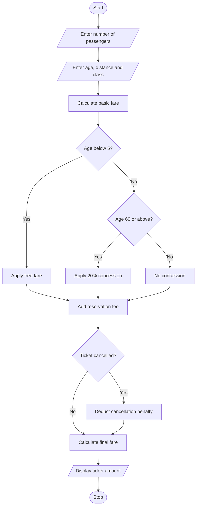

#1. Problem Statement
To develop a Python program to calculate railway fares for multiple passengers based on travel distance, travel class, age-based concessions, and reservation fees. The program also calculates cancellation penalties and displays the final ticket amount.

#2.Assumptions
1. The number of passengers is entered by the user.
2. Fare depends on the distance travelled.
3. Different travel classes have different fares per kilometre.
4. Children below 5 years travel free.
5. Passengers aged 60 and above get a 20% concession.
6. Reservation fee is ₹50 per passenger.
7. Cancellation penalty is ₹100 per passenger.
8. Distance and age must be positive values.

#3. Algorithm
1. Start the program.
2. Read the number of passengers.
3. Read passenger name, age and travel distance.
4. Select the travel class.
5. Calculate the basic fare using distance and class rate.
6. Apply age-based concession.
7. Add reservation fee.
8. Calculate the final fare.
9. Ask whether the ticket is cancelled.
10. If cancelled, deduct the cancellation penalty.
11. Display the final amount.
12. Stop the program.

#5.pseudo code

START
INPUT number of passengers

FOR each passenger:
    INPUT name, age, distance
    INPUT travel class

    IF class is Sleeper:
        rate = 2
    ELSE IF class is AC:
        rate = 4
    ELSE:
        rate = 1

    fare = distance * rate

    IF age < 5:
        fare = 0
    ELSE IF age >= 60:
        fare = fare - (fare * 20 / 100)

    total = fare + 50

    INPUT cancellation choice

    IF cancelled:
        total = total - 100
        IF total < 0:
            total = 0

    DISPLAY total

END FOR

#6.python source code

n = int(input("Enter number of passengers: "))

for i in range(n):
    print("\nPassenger", i + 1)

    name = input("Enter name: ")
    age = int(input("Enter age: "))
    distance = float(input("Enter distance: "))

    print("1. General  2. Sleeper  3. AC")
    choice = int(input("Select class: "))

    if choice == 1:
        rate = 1
    elif choice == 2:
        rate = 2
    elif choice == 3:
        rate = 4
    else:
        print("Invalid class")
        continue

    fare = distance * rate

    if age < 5:
        fare = 0
    elif age >= 60:
        fare = fare * 0.80

    total = fare + 50

    cancel = input("Cancel ticket? (yes/no): ")

    if cancel.lower() == "yes":
        total = max(0, total - 100)

    print("\n--- Railway Bill ---")
    print("Name:", name)
    print("Final Fare: Rs.", total)

print("\nCalculation Completed")

#7.sample output

Enter number of passengers: 1

Passenger 1
Enter name: Ravi
Enter age: 65
Enter distance: 100

1. General  2. Sleeper  3. AC
Select class: 2
Cancel ticket? (yes/no): no

--- Railway Bill ---
Name: Ravi
Final Fare: Rs. 210.0

#8.conclusion
This Python program calculates railway fares for multiple passengers based on distance, travel class and age concessions. It also adds reservation fees and calculates cancellation penalties. Thus, it makes railway fare calculation simple and easy.

