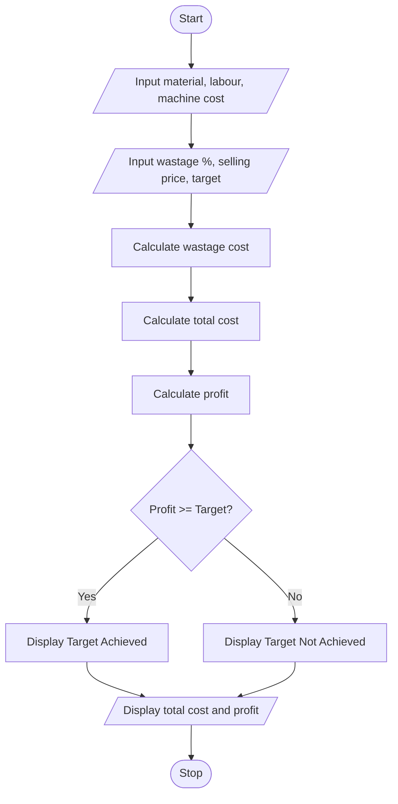

#1. Problem Statement
To develop a Python program to calculate the total manufacturing cost, including material cost, labour charges, wastage cost, and machine cost. Calculate the selling price and check whether the production meets the specified profit target.

#2. Assumptions
1. Material cost, labour cost and machine cost are entered by the user.
2. Wastage cost is calculated as a percentage of material cost.
3. Selling price is entered by the user.
4. Profit = Selling Price − Total Cost.
5. Profit target is given by the user.
6. All costs must be positive.

#3. Algorithm
1. Start.
2. Read material, labour and machine costs.
3. Read wastage percentage, selling price and profit target.
4. Calculate wastage cost.
5. Calculate total manufacturing cost.
6. Calculate profit.
7. Compare profit with target.
8. Display total cost and profit.
9. Display whether the target is achieved.
10. Stop.

#5.pseudo code

START
INPUT material, labour, machine
INPUT wastage_percent, selling_price, target

wastage = material * wastage_percent / 100
total_cost = material + labour + machine + wastage
profit = selling_price - total_cost

IF profit >= target THEN
    PRINT "Target Achieved"
ELSE
    PRINT "Target Not Achieved"
END IF

PRINT total_cost, profit

#6.python source code

material = float(input("Enter material cost: "))
labour = float(input("Enter labour cost: "))
machine = float(input("Enter machine cost: "))

waste = float(input("Enter wastage percentage: "))
selling = float(input("Enter selling price: "))
target = float(input("Enter profit target: "))

wastage = material * waste / 100

total = material + labour + machine + wastage
profit = selling - total

print("Wastage Cost:", wastage)
print("Total Manufacturing Cost:", total)
print("Profit:", profit)

if profit >= target:
    print("Profit Target Achieved")
else:
    print("Profit Target Not Achieved")

 #7.sample output

 Enter material cost: 10000
Enter labour cost: 3000
Enter machine cost: 2000
Enter wastage percentage: 10
Enter selling price: 20000
Enter profit target: 3000

Wastage Cost: 1000
Total Manufacturing Cost: 16000
Profit: 4000
Profit Target Achieved

#8.conclusion
This Python program calculates the total manufacturing cost and profit. It also checks whether the production meets the given profit target using conditional statements.
