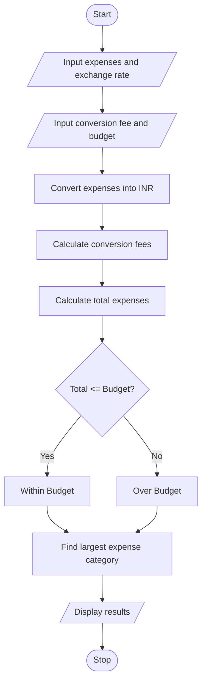

#1. Problem Statement
To develop a Python program to convert travel expenses from foreign currency into local currency using exchange rates. Calculate conversion fees, compare total expenses with the budget, and identify the largest expense category.

#2. Assumptions
1. User enters travel expenses in foreign currency.
2. Exchange rate is provided by the user.
3. Conversion fee is calculated as a percentage.
4. Budget is entered in local currency (INR).
5. Expense categories include food, travel and shopping.
6. All amounts must be positive.

#3. Algorithm
1. Start.
2. Input food, travel and shopping expenses.
3. Input exchange rate and conversion fee percentage.
4. Convert expenses into INR.
5. Calculate conversion fees.
6. Calculate total expenses.
7. Compare expenses with budget.
8. Identify the largest expense category.
9. Display the results.
10. Stop.

#5.pseudo code

START
INPUT food, travel, shopping
INPUT rate, fee, budget

food_cost = food * rate
travel_cost = travel * rate
shopping_cost = shopping * rate

subtotal = food_cost + travel_cost + shopping_cost
conversion_fee = subtotal * fee / 100
total = subtotal + conversion_fee

IF total <= budget
    PRINT "Within Budget"
ELSE
    PRINT "Over Budget"
END IF

FIND largest expense category
PRINT total, conversion_fee, largest category

#6.python source code

food = float(input("Enter food expense: "))
travel = float(input("Enter travel expense: "))
shopping = float(input("Enter shopping expense: "))

rate = float(input("Enter exchange rate: "))
fee = float(input("Enter conversion fee percentage: "))
budget = float(input("Enter budget in INR: "))

f = food * rate
t = travel * rate
s = shopping * rate

subtotal = f + t + s
charges = subtotal * fee / 100
total = subtotal + charges

print("Food Cost:", f)
print("Travel Cost:", t)
print("Shopping Cost:", s)
print("Conversion Fee:", charges)
print("Total Expense:", total)

if total <= budget:
    print("Within Budget")
else:
    print("Over Budget")

if f >= t and f >= s:
    print("Largest Expense: Food")
elif t >= f and t >= s:
    print("Largest Expense: Travel")
else:
    print("Largest Expense: Shopping")

#7.sample output

Enter food expense: 100
Enter travel expense: 200
Enter shopping expense: 150
Enter exchange rate: 80
Enter conversion fee percentage: 2
Enter budget in INR: 40000

Food Cost: 8000
Travel Cost: 16000
Shopping Cost: 12000
Conversion Fee: 720
Total Expense: 36720

Within Budget
Largest Expense: Travel

#8.conclusion
This Python program converts foreign travel expenses into INR, calculates conversion fees, checks the budget and identifies the largest expense category using conditional statements.

